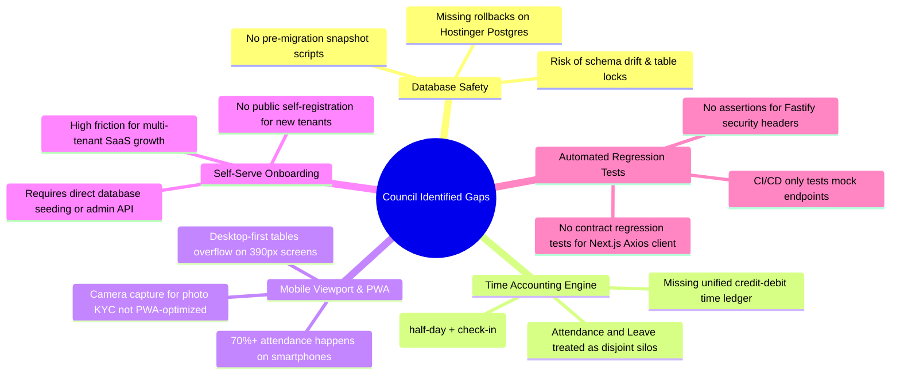

# Council-Identified Gaps & Consensus Blind Spots

> **Council Phase**: Step 3 Synthesis  
> **Source**: Cross-Review of 5 Independent Perspectives + Empirical Codebase Findings

---

## 1. The 5 Critical Blind Spots Uncovered

Through the peer review process, five critical gaps were uncovered that were initially missed by individual technical deep-dives:



---

### Gap 1: Database Migration & Automated Snapshot Safety
* **Context**: The database lives on Hostinger PostgreSQL (`187.126.125.239:5432`) and Render. It holds 77 models and 78 tables across live tenants (`acme-corp-001`, `test-key-123456789`).
* **Blind Spot**: Neither the developer build plans nor the architecture audits included automated database backup snapshots prior to running `npx prisma migrate deploy`. If an engineer alters a table or renames an enum on production, data corruption could be irreversible.
* **Remediation**: Add a pre-deploy hook in CI/CD:
  ```bash
  pg_dump -U employee_management_database_ibyc_user -h 187.126.125.239 employee_management_database_ibyc > backup_$(date +%s).sql
  ```

---

### Gap 2: Unified Time Accounting Engine (Attendance ↔ Leave Silo)
* **Context**: Attendance records and Leave requests currently run through completely separate controllers, repositories, and calculation loops.
* **Blind Spot**: When an employee applies for a half-day leave or comp-off, the attendance engine does not cross-reference the leave balance ledger in real time. An employee can check in for a full day while simultaneously being marked on approved sick leave, creating contradictory legal records.
* **Remediation**: Unify state resolution under a single `TimeLedgerService` that computes daily status using a prioritized evaluation chain:
  1. Approved Leave -> 2. Company Holiday -> 3. Biometric / Web Check-In -> 4. Weekend -> 5. Absent.

---

### Gap 3: Mobile Viewport & PWA Experience
* **Context**: Real-world employees access HRMS portals predominantly from smartphones (iOS Safari, Android Chrome) at 8:45 AM when walking into an office.
* **Blind Spot**: `ems-frontend` has heavily styled desktop data tables (`EmployeeTable`, `PayrollRunTable`, `AttendanceCalendar`) with min-widths of 800px+. On a standard 390px mobile viewport, tables overflow horizontally and check-in buttons get pushed below the fold.
* **Remediation**: Implement responsive card layouts for viewports `< 768px` and add Web App Manifest (`manifest.json`) for one-tap Add to Home Screen PWA installation.

---

### Gap 4: Self-Service Tenant Onboarding Funnel
* **Context**: EMS is designed as a multi-tenant SaaS application with subdomain routing (`acme.yourems.com`).
* **Blind Spot**: There is no self-serve signup screen in `ems-frontend`. A new company cannot visit `app.yourems.com/signup`, create an organization, configure their work week, and invite their team. Tenants must currently be provisioned manually by executing database seeds or calling protected admin APIs.
* **Remediation**: Build `/register-company` with an onboarding wizard (Company Name, Slug, Admin Email, Working Days, Fiscal Year start).

---

### Gap 5: Automated Contract & Security Regression Suite
* **Context**: Contract drift (like `GET` vs `POST` on `/leave/requests/preview` and 5 vs 10 char reason lengths) occurred because tests were written against mocks rather than live Fastify routes with AJV schemas.
* **Blind Spot**: The test suite in `tests/` does not assert the presence of security headers (CORS, Helmet, Rate Limit) or validate that frontend Zod schemas match backend AJV schemas.
* **Remediation**: Add Supertest integration tests specifically verifying:
  1. `Strict-Transport-Security` and `X-Frame-Options` on every route.
  2. Exact boundary tests for form fields (e.g., submitting 5-char reason strings).
