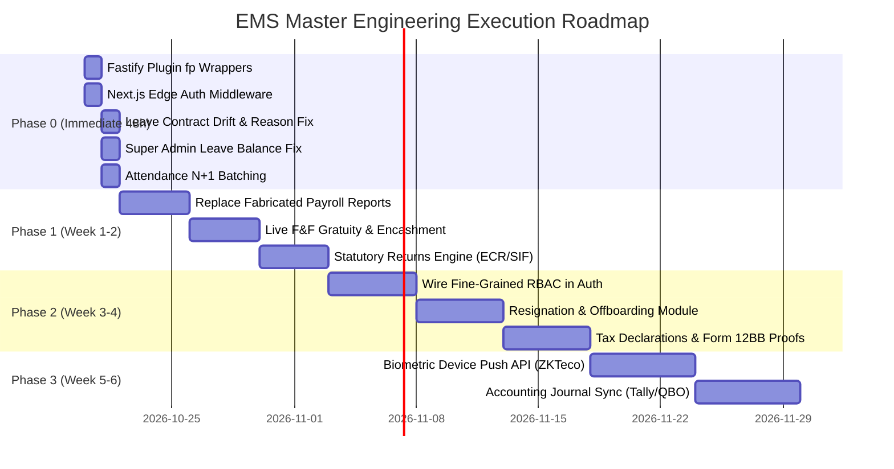

# Master Actionable Build Plan

> **Author**: Gemini (Google DeepMind Antigravity)  
> **Target Execution**: Immediate Engineering Roadmap for EMS Backend & Frontend  
> **Database & Cache**: PostgreSQL 16 + Redis 7 (`187.126.125.239`)  
> **Success Criteria**: Zero contract drift, 100% compliance integrity, sub-200ms API response latency

---

## Roadmap Overview



---

## Phase 0: Immediate Critical Fixes (48 Hours)

### Task 0.1: Wrap Fastify Security & Infrastructure Plugins with `fastify-plugin`
* **Objective**: Ensure Helmet security headers, CORS origin verification, and Rate Limiting apply globally across all `/api/v1/*` routes.
* **Target Files**:
  * `src/plugins/cors.js`
  * `src/plugins/helmet.js`
  * `src/plugins/rateLimit.js`
* **Implementation**:
  ```javascript
  // src/plugins/cors.js
  import fp from 'fastify-plugin';
  import cors from '@fastify/cors';
  import config from '../config/index.js';

  async function corsPlugin(fastify, opts) {
    await fastify.register(cors, {
      origin: config.corsOrigin,
      credentials: true,
      methods: ['GET', 'POST', 'PUT', 'PATCH', 'DELETE', 'OPTIONS'],
    });
  }
  export default fp(corsPlugin);
  ```
* **Verification**:
  `curl -I http://localhost:4000/api/v1/auth/me` must return:
  - `Access-Control-Allow-Origin: http://localhost:3001`
  - `x-ratelimit-limit: 100`
  - `X-Content-Type-Options: nosniff`

---

### Task 0.2: Implement Edge Authentication Middleware in Next.js
* **Objective**: Prevent unauthenticated users from downloading proprietary client script bundles on protected routes.
* **Target File**: `ems-frontend/src/middleware.ts`
* **Implementation**:
  ```typescript
  import { NextResponse } from 'next/server';
  import type { NextRequest } from 'next/server';

  export function middleware(request: NextRequest) {
    const token = request.cookies.get('accessToken')?.value;
    const { pathname } = request.nextUrl;

    const isPublic =
      pathname.startsWith('/login') ||
      pathname.startsWith('/forgot-password') ||
      pathname.startsWith('/reset-password') ||
      pathname.startsWith('/_next') ||
      pathname.startsWith('/api') ||
      pathname === '/favicon.ico';

    if (!token && !isPublic) {
      const loginUrl = new URL('/login', request.url);
      loginUrl.searchParams.set('from', pathname);
      return NextResponse.redirect(loginUrl);
    }
    return NextResponse.next();
  }

  export const config = {
    matcher: ['/((?!api|_next/static|_next/image|favicon.ico).*)'],
  };
  ```
* **Verification**:
  `curl -s -o /dev/null -w "%{http_code}" http://localhost:3001/dashboard` must return `307` or `302`.

---

### Task 0.3: Resolve Leave Preview Contract Drift & Validation Bounds
* **Objective**: Support both `GET` and `POST` for leave preview, and synchronize reason length bounds between UI (min 5) and Backend (min 5).
* **Target Files**:
  * `src/modules/leave/leave.routes.js`
  * `src/modules/leave/leave.validator.js`
* **Implementation**:
  In `leave.routes.js`:
  ```javascript
  // Support both GET and POST to handle client-side axios query calls seamlessly
  fastify.get('/requests/preview', { preHandler: [authenticate] }, controller.previewQuery);
  fastify.post('/requests/preview', { preHandler: [authenticate] }, controller.preview);
  ```
  In `leave.validator.js`:
  ```javascript
  reason: { type: 'string', minLength: 5, maxLength: 500 },
  ```

---

### Task 0.4: Fix Super Admin Leave Balance Query Sum Collapse
* **Objective**: Prevent Super Admin leave queries from aggregating all employee balances in the company.
* **Target File**: `src/modules/leave/leaveEngine.repository.js:76`
* **Implementation**:
  ```javascript
  async getLeaveBalances(tenantId, employeeId) {
    if (!employeeId) {
      return []; // Admin accounts without an employee profile have 0 leave ledger balance
    }
    return prisma.leaveBalance.findMany({
      where: { tenantId, employeeId },
      include: { leaveType: true }
    });
  }
  ```

---

### Task 0.5: Batch Attendance Team Calculation (Eliminate N+1 Query Loop)
* **Objective**: Drop team attendance view loading latency from 3.7 seconds to < 180ms.
* **Target File**: `src/modules/attendance/attendance.service.js:419`
* **Implementation**:
  ```javascript
  // Replace per-employee loop with 2 bulk queries
  const memberIds = teamMembers.map(m => m.id);
  const [allRecords, allHolidays] = await Promise.all([
    prisma.attendanceRecord.findMany({
      where: {
        tenantId,
        employeeId: { in: memberIds },
        date: { gte: startDate, lte: endDate }
      }
    }),
    prisma.holiday.findMany({
      where: {
        tenantId,
        date: { gte: startDate, lte: endDate }
      }
    })
  ]);

  // Group in-memory with Map
  const recordsByEmp = new Map();
  for (const r of allRecords) {
    if (!recordsByEmp.has(r.employeeId)) recordsByEmp.set(r.employeeId, []);
    recordsByEmp.get(r.employeeId).push(r);
  }
  ```

---

## Phase 1: Core Engine Integrity & Compliance (Week 1–2)

### Task 1.1: Replace Fabricated Payroll Reports with Live Database Aggregations
* **Objective**: Query `prisma.payslip` directly for gross pay, statutory deductions, and net disbursements.
* **Target File**: `src/modules/reports/reports.repository.js:669`
* **Implementation**:
  ```javascript
  async getPayrollSummary(tenantId, fromDate, toDate) {
    const payslips = await prisma.payslip.findMany({
      where: {
        tenantId,
        payPeriod: { gte: fromDate, lte: toDate }
      },
      select: {
        grossEarnings: true,
        totalDeductions: true,
        netPay: true,
        payPeriod: true
      }
    });

    const summaryMap = new Map();
    for (const p of payslips) {
      const current = summaryMap.get(p.payPeriod) || { gross: 0, deductions: 0, net: 0, count: 0 };
      current.gross += Number(p.grossEarnings);
      current.deductions += Number(p.totalDeductions);
      current.net += Number(p.netPay);
      current.count += 1;
      summaryMap.set(p.payPeriod, current);
    }
    return Array.from(summaryMap.entries()).map(([period, data]) => ({
      period,
      totalGrossPay: data.gross,
      totalDeductions: data.deductions,
      totalNetPay: data.net,
      employeeCount: data.count,
      status: 'PROCESSED'
    }));
  }
  ```

---

### Task 1.2: Implement Real Full & Final (F&F) Settlement Calculation
* **Objective**: Calculate statutory leave encashment and gratuity under labor law instead of hardcoding `0`.
* **Target File**: `src/modules/payroll/payroll.service.js:1052`
* **Calculation Formulas**:
  * **Leave Encashment**: `(Basic Salary / 30) * Remaining Paid Leave Days`
  * **Statutory Gratuity (India)**: `(15 * Last Drawn Basic * Tenure in Years) / 26` (for employees with >= 5 years of service)
  * **Statutory EOSB (UAE / GCC)**: `(21 days Basic * Years 1-5) + (30 days Basic * Years > 5)`

---

### Task 1.3: Generate Real Statutory Return Files (EPFO ECR / WPS SIF)
* **Objective**: Provide valid text files for bank disbursal and government compliance.
* **Target File**: `src/modules/payroll/payroll.service.js:1062`
* **Formats Implemented**:
  * **EPFO ECR (Electronic Challan cum Return)**: `#~#` delimited format with UAN, Member Name, Gross Wages, EPF Wages, EPS Wages, EE Contribution, ER EPF Share, ER EPS Share.
  * **WPS SIF (Wage Protection System Salary Information File)**: Fixed-width or comma-delimited record compliant with Saudi / UAE Central Bank requirements.

---

## Phase 2: Enterprise RBAC & Workflow Automation (Week 3–4)

### Task 2.1: Wire Prisma Fine-Grained Permissions into `authenticate.js`
* **Objective**: Connect the 120+ permissions stored in `RolePermission` so that custom roles take effect.
* **Target File**: `src/middleware/authenticate.js`
* **Implementation**:
  ```javascript
  export function checkPermission(permissionKey) {
    return async function (request, reply) {
      const { user } = request;
      if (user.memberType === 'SUPER_ADMIN') return; // Master bypass

      // Fetch user's assigned roles and associated permission keys from DB (cached in Redis)
      const userPermissions = await getUserPermissionsCached(user.id, user.tenantId);
      if (!userPermissions.includes(permissionKey)) {
        return reply.status(403).send({
          statusCode: 403,
          error: 'Forbidden',
          message: `Missing required permission: ${permissionKey}`
        });
      }
    };
  }
  ```

---

### Task 2.2: Build Resignation & Offboarding Module
* **Objective**: Expose full resignation lifecycle backed by existing `Resignation` Prisma model.
* **New Routes**:
  * `POST /api/v1/resignations/submit` (Employee initiates)
  * `GET /api/v1/resignations/my` (Employee status check)
  * `GET /api/v1/resignations/team` (Manager / HR review queue)
  * `PATCH /api/v1/resignations/:id/approve` (HR accepts, sets last working day)
  * `POST /api/v1/resignations/:id/settle` (Triggers F&F calculation)

---

### Task 2.3: Implement Form 12BB Tax Declarations & Investment Proofs
* **Objective**: Enable employees to declare Section 80C, 80D, and HRA investments, upload PDF receipts, and have HR approve deductions prior to fiscal year-end TDS calculations.

---

## Phase 3: Hardware Integrations & Scale (Week 5–6)

### Task 3.1: Biometric Attendance Listener Service (ZKTeco / eSSL)
* **Objective**: Expose a secure webhook listener endpoint `/api/v1/attendance/biometric-push` accepting ADMS (Automatic Data Master Server) HTTP POST logs from biometric clock machines.

### Task 3.2: Accounting General Ledger Sync (Tally / QuickBooks)
* **Objective**: Automated generation of double-entry accounting journals (Debiting Payroll Expense, Crediting Salary Payable and Tax Liabilities) formatted for Tally XML or QuickBooks Online REST API.
